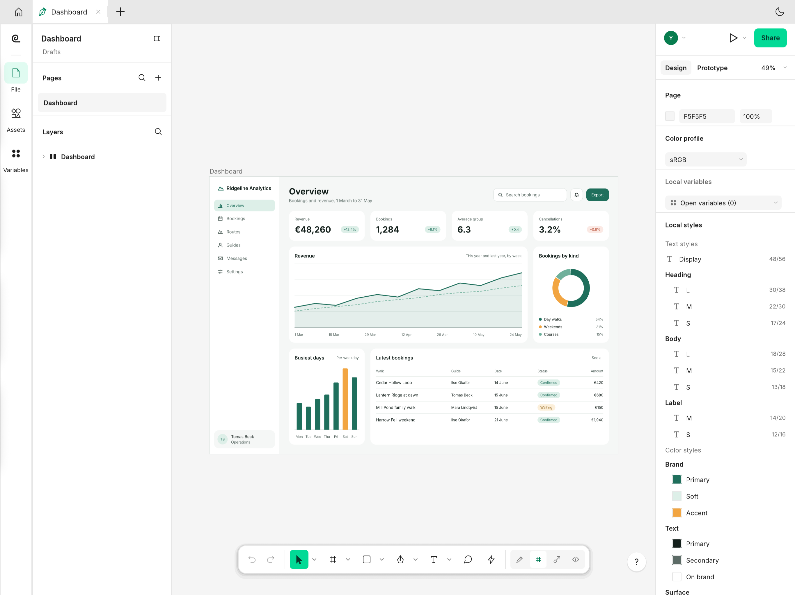
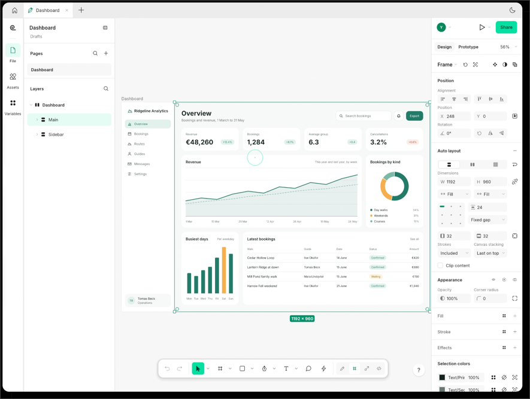

# FigCraft for iPadOS (fork)

<p align="center">
  
  <br>
  <sub>FigCraft running on an iPad Air 13-inch (M3).</sub>
</p>

This fork exists for the **iPadOS port** of FigCraft, an open-source, clean-room interface design and
prototyping tool written in Rust. To learn about the project itself (features, file formats, desktop and
web builds, downloads, the other Crafting Apps, contributing), read the upstream README:
**[storytold/figcraft](https://github.com/storytold/figcraft#readme)**.

> **This README belongs to the fork.** When upstream changes are merged, keep this file and drop
> upstream's `README.md` (see [Merging upstream](#merging-upstream)).

## What this fork adds

### Touch and Apple Pencil, verified on an iPad Air (M3)

The iPad app works the way a drawing app does. This is verified on a physical iPad Air 13-inch (M3).

- **Apple Pencil draws and edits with the active tool.** It is told apart from a finger by its UIKit touch
  type, and records pen pressure.
- **A hover reticle shows where the Pencil will land.** A ring and dot float at the tip while the Pencil
  hovers over the canvas. The ring closes in and brightens as the tip nears the glass, and everything
  disappears when the tip touches down, the hover ends or the tip leaves the canvas. It is drawn in
  screen points, so zooming does not resize it, and it is no part of the document or an export. Turn it off in
  Preferences ▸ *Show a reticle where the Apple Pencil hovers* (on by default).
- **A finger taps and pans.** A press on something the Move or Scale tool can grab still drives the tool;
  anywhere else a tap is a click for the tool and a drag pans the canvas.
- **Two fingers pan and pinch** in the same frame, and a second finger drops the half-drawn shape or drag
  the first one began.
- **The bottom bar clears the home indicator** and carries Undo and Redo, on the iPad only.

<p align="center">
  
  <br>
  <sub>The hover reticle, with the Pencil just above the glass.</sub>
</p>

### The port itself

- **`apps/figcraft-ios`**: a Rust static-library runner (single UIKit window scene attached to winit's
  window, safe-area insets taken from UIKit every frame, preferences in the app container, live sessions
  and system-font indexing as on the desktop). Open imports a copy of the file into the app container and
  remembers where it came from; Save reserves a file there, and a change tracker takes each saved document
  to the export picker the first time and to the remembered location after.
- **`packaging/ios`**: the Xcode project that links the library into an iPad app bundle, with a bundle
  validator and tests. See its [README](packaging/ios/README.md).
- **`cargo xtask ios`**: build, install and launch on the Simulator or a physical iPad
  (`--sim`, `--device --device-id <id> --team <id> [--bundle-id <dev id>]`).
- **No Discord links.** The About dialog link, its string in every language and the packaging help links
  are gone.

## Status

**Verified on an iPad Air 13-inch (M3):** the app builds, installs and launches; touch (tap, pan, pinch);
the Apple Pencil drawing with the active tool; and the hover reticle.

**Verified in the iPad Air 11-inch (M3) simulator** (iPadOS 26.2): the home screen draws in portrait inside
the safe area.

**Not yet verified:** opening and saving through the Files picker, an external keyboard and its shortcuts,
live sessions, multitasking, Release builds. Not wired up: choosing a folder (multi-file export is
cancelled), the system clipboard, opening URLs, crash-recovery copies.

Apple Pencil hover needs hardware that reports it (iPadOS 16.1 or later). Where the hover height is not
reported, the ring stays at its smallest size.

## Build and run

Requires macOS with Xcode and the Rust targets `aarch64-apple-ios`, `aarch64-apple-ios-sim` and
`x86_64-apple-ios`.

```sh
cargo xtask ios --sim          # build, boot, install and launch on the iPad simulator
cargo xtask ios --device --device-id <udid> --team <team id> --bundle-id <your.dev.bundle.id>
cargo test -p figcraft-ios --lib
cargo test -p figcraft-ui-egui --lib picks
python3 -m unittest discover -s packaging/ios/tests -v
```

`xcrun devicectl list devices` lists the connected iPad's identifier. Signing is explained in
[`packaging/ios/README.md`](packaging/ios/README.md).

Contributor rules (clean-room, never crash, layering, assets) are in [`AGENTS.md`](AGENTS.md).

## Merging upstream

`.gitattributes` marks `README.md` with `merge=ours`, so a merge of `upstream/main` keeps this file. Git
only honours that after a one-time, per-clone setting:

```sh
git config merge.ours.driver true
```

Without it, resolve a README conflict with `git checkout --ours README.md`.

## License and attribution

Dual-licensed MIT OR Apache-2.0, as upstream. Assets are listed in [`ATTRIBUTION.md`](ATTRIBUTION.md).
