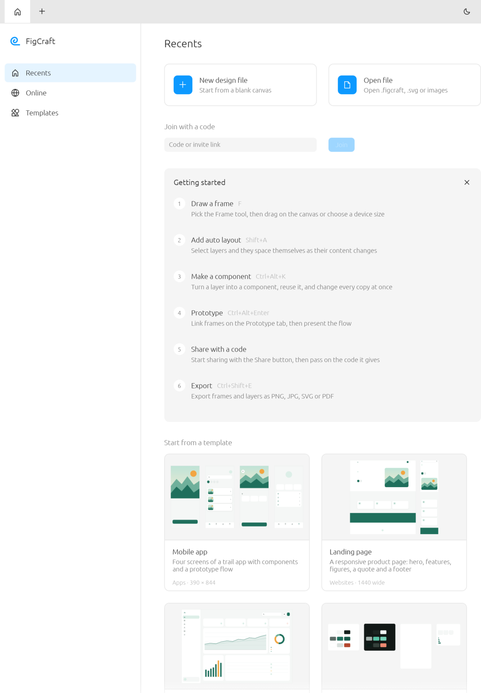

# FigCraft for iPadOS (fork)

<p align="center">
  
  <br>
  <sub>FigCraft on iPadOS, in portrait (iPad Air 11-inch simulator).</sub>
</p>

This fork exists only for the **iPadOS port** of FigCraft, an open-source, clean-room interface design
and prototyping tool written in Rust. To learn about the project itself (features, file formats, desktop
and web builds, downloads, the other Crafting Apps, contributing), read the upstream README:
**[storytold/figcraft](https://github.com/storytold/figcraft#readme)**.

## What this fork adds

- **`apps/figcraft-ios`**: a Rust static-library runner (single UIKit window scene attached to winit's
  window, safe-area insets taken from UIKit every frame, preferences in the app container, live sessions
  and system-font indexing as on the desktop). Open imports a copy of the file into the app container and
  remembers where it came from; Save reserves a file there, and a change tracker takes each saved document
  to the export picker the first time and to the remembered location after.
- **Pickers that answer later** (`crates/ui-egui/src/picks.rs`): `Services` gains `begin_pick` and
  `poll_pick`, because UIDocumentPicker needs the main thread's run loop that egui draws on, so a blocking
  `pick_open` would deadlock. Platforms that do not implement them (desktop, web) keep the blocking calls
  and behave as before.
- **`packaging/ios`**: the Xcode project that links the library into an iPad app bundle, with a bundle
  validator and tests. See its [README](packaging/ios/README.md).
- **`cargo xtask ios`**: build, install and launch on the Simulator or a physical iPad
  (`--sim`, `--device --device-id <id> --team <id> [--bundle-id <dev id>]`).
- **No Discord links.** The About dialog link, its string in every language and the packaging help links
  are gone.

## Status

Verified in the iPad Air 11-inch M3 simulator (iPadOS 26.2, 2026-10-13): the app builds, installs, launches
and draws the home screen in portrait inside the safe area.

**Not yet verified:** opening and saving through the Files picker, touch, Apple Pencil, an external
keyboard and its shortcuts, live sessions, multitasking, landscape, Release builds, anything on a physical
iPad. Not wired up: choosing a folder (multi-file export is cancelled), the system clipboard, opening URLs,
crash-recovery copies. This is a first bootstrap, not a hardware sign-off.

## Build and run

Requires macOS with Xcode and the Rust targets `aarch64-apple-ios`, `aarch64-apple-ios-sim` and
`x86_64-apple-ios`.

```sh
cargo xtask ios --sim          # build, boot, install and launch on the iPad simulator
cargo xtask ios --device --device-id <udid> --team <team id> --bundle-id <your.dev.bundle.id>
cargo test -p figcraft-ios --lib
cargo test -p figcraft-ui-egui --lib picks
python3 -m unittest discover -s packaging/ios/tests -v
```

Contributor rules (clean-room, never crash, layering, assets) are in [`AGENTS.md`](AGENTS.md).

## License and attribution

Dual-licensed MIT OR Apache-2.0, as upstream. Assets are listed in [`ATTRIBUTION.md`](ATTRIBUTION.md).
